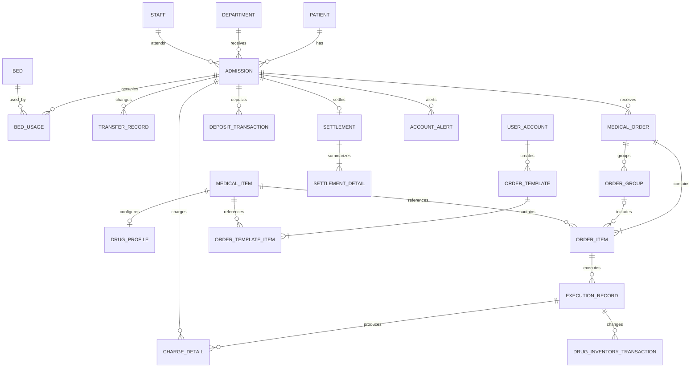
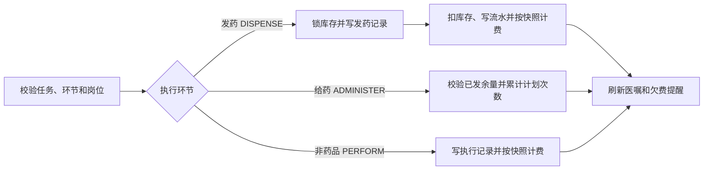

# ER 与关系设计

## 核心 ER 图

## 关键建模选择

1. 患者与住院分离，使一个患者可多次住院。
2. 床位当前状态用于快速查询，`bed_usage` 保存不可覆盖的占用历史。
3. 医嘱表达医生意图，执行记录表达实际发生，两者不能合并。
4. 医疗项目统一父目录，通过 `item_type` 区分药品、检查、检验、治疗、护理、饮食、其他和床位费；药品专属换算与途径放在一对一的 `drug_profile`。
5. 押金、费用和库存均采用流水；冲正引用原记录。
6. 结算主表保存总额快照，明细按类别保存，历史价格变化不回溯。
7. 医嘱头只聚合一次开立，长期/临时、剂量、价格、执行岗位与进度保存在项目层；配液组通过 `order_group` 约束同组原子执行。
8. `order_template` 只保存可编辑项目清单，不复制剂量和患者业务事实。

## 3NF 说明

- 每张业务表均有稳定主键，非主属性完全依赖主键。
- 患者、科室、床位、员工、医疗项目等描述属性不复制进交易主表；交易仅保存外键及必要快照。
- 价格快照、押金流水和结算汇总属于发生时业务事实，不是可由当前主数据替代的冗余。
- RBAC 使用用户—角色和角色—权限两个关联表消除多值字段。

## 关键事务

