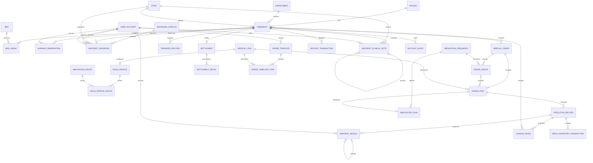
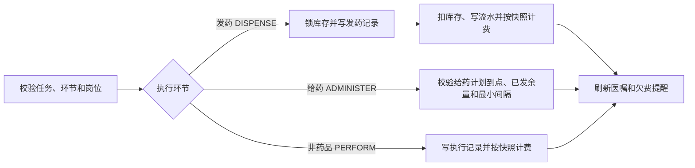

# ER 与关系设计

## 核心 ER 图

## 关键建模选择

1. 患者与住院分离，使一个患者可多次住院。
2. 床位当前状态用于快速查询，`bed_usage` 保存不可覆盖的占用历史。
3. 医嘱表达医生意图，执行记录表达实际发生，两者不能合并。
4. 医疗项目统一父目录，通过 `item_type` 区分药品、检查、检验、治疗、护理、饮食、其他和床位费；药品专属换算放在一对一的 `drug_profile`，多值给药途径通过 `medication_route` 与 `drug_profile_route` 关联。
5. 押金、费用和库存均采用流水；冲正引用原记录。
6. 结算主表保存总额快照，明细按类别保存，历史价格变化不回溯。
7. 医嘱头只聚合一次开立，长期/临时、剂量、价格、执行岗位与进度保存在项目层；配液组通过 `order_group` 约束同组原子执行。
8. `order_template` 只保存可编辑项目清单，不复制剂量和患者业务事实。
9. 诊断目录与住院诊断分离；住院诊断保留编码/名称快照，临床记录保留签署事实，避免主数据或后续编辑改写历史含义。
10. 药品的给药计划从医嘱项目中拆出：`medication_frequency` 是可软停用的参考主数据，`medication_plan` 以 `order_item_id` 为主键形成一对一子类型；频次、首次给药时间和有效期表达医生意图，`execution_record` 表达实际给药事实。
11. 给药途径不再以逗号分隔字符串存储。`medication_route` 保存稳定编码和名称，`drug_profile_route` 保存药品允许的途径及目录顺序；`order_item.route` 仍是开立时快照，防止停用或维护主数据改写历史医嘱。
12. 费用流水的 `item_type_snapshot` 保存发生时的项目类别；正常费用继承医嘱项目快照，手工费用校验当前目录，冲正费用继承原费用快照，使结算明细、收入统计不依赖后续可变目录。
13. 费用流水同时保存项目编码、名称和计费单位快照。项目外键保留可追溯关系，但历史费用展示不再依赖可变医疗项目目录。

## V6 完整性加固

- `order_item(group_id, medical_order_id)` 复合外键引用 `order_group(id, medical_order_id)`，避免把别的医嘱的配液组挂接过来。
- `account_alert.open_admission_key` 是 OPEN 状态下的生成列唯一键，同一住院只能存在一条待处理欠费提醒。
- `medical_item`、`drug_profile` 和 `order_item` 共同保证药品必须走库存/剂量模型，非药品不能携带药品字段。
- 执行记录按环节核对项目类型和记录单位，库存流水按有符号数量核对前后库存；这些规则即使绕过后端也由数据库拒绝非法事实。

## V7 住院护理观察

- `nursing_observation` 直接归属于一次 `admission`，不引入门诊就诊实体；同一患者再次住院时会形成新的观察时间序列。
- `request_no` 是跨住院全局唯一的客户端请求幂等键，`(admission_id, observed_at)` 防止同一住院同一时刻重复采集；记录人通过 `user_account -> staff` 关联，避免把姓名冗余到业务事实中。
- 生命体征字段允许部分填写，但数据库强制至少有一项测量，并校验体温、脉搏、呼吸、血压、血氧及意识枚举；血压必须成对填写，且收缩压高于舒张压。
- 观察时间必须位于住院有效时间窗，且只能由在职护士或管理员新增；更新和删除由数据库触发器拒绝，更正通过新的观察事实表达。

## V8 住院检查检验结果

- `inpatient_result` 以 `execution_record` 为来源，只接受本次住院中检查/检验项目的未冲正成功 `PERFORM` 执行；`admission_id`、`order_item_id` 和 `execution_id` 由数据库触发器交叉核对，防止跨住院或跨医嘱挂接结果。
- 一次检查/检验执行可以产生多个 `analyte_code` 结果，避免把血常规等多指标报告压成一个不可拆分字段；`result_value` 与 `result_text` 至少有一个，单位、参考范围和异常标记保留发生时解释。
- `result_no` 用于请求幂等；`(execution_id, analyte_code, amendment_parent_key)` 保证一条检验项目只有一个当前版本及一条直接更正链；自引用复合外键 `(amends_result_id, execution_id, analyte_code)` 直接保证更正父项来自同一执行和同一检验项目。结果表不允许 UPDATE/DELETE，更正通过 `amends_result_id` 自引用新增，并要求递进报告时间。
- `recorded_by` 与 `verified_by` 使用账号外键，实际执行人沿用 `execution_record.executor_id`；有 `RESULT_RECORD` 权限且属于本科室的医生/护士或管理员才可记录/审核，仍受住院数据范围控制。

## V9 住院诊断与临床记录

- `diagnosis_catalog` 是可软停用的诊断编码主数据，`inpatient_diagnosis` 通过复合外键同时锁定目录 ID、编码系统和编码快照；目录名称后续调整不会改变既有住院诊断的历史显示。
- `inpatient_diagnosis` 是一次住院中的诊断断言，按 `diagnosis_type` 区分入院、主要、次要、并发症和出院诊断；有效诊断按住院、目录和类型去重，`PRIMARY` 类型通过生成列保证每次住院最多一条有效主要诊断。
- 诊断只能从 `ACTIVE` 转为 `RESOLVED` 或 `RULED_OUT`，不能删除或篡改诊断身份；解决人、解决时间和说明单独保存并进入审计。
- `inpatient_clinical_note` 只覆盖受控的住院记录类型，不等同于完整电子病历系统。签署记录是不可变事实；更正记录通过 `(amends_note_id, admission_id, note_type, amends_note_signed_at)` 复合外键保持同一住院、同一类型并验证原签署时间，再用父记录唯一约束避免分叉更正。
- 入院评估和出院小结各允许一条原始记录；病程和病情变化记录可按时间形成序列。作者必须是本住院科室在职医生，登记/签署人员必须具备 `CLINICAL_RECORD` 权限。

## V10 药品给药计划

- `medication_frequency` 保存频次编码、展示名、最小间隔分钟数和是否一次性；频次是参考数据，不把“每日几次”复制到每条医嘱文本中。`ONCE` 的间隔为0，其余频次必须为正间隔。
- 频次编码的间隔和一次性语义一经被计划引用不可修改；频次可以软停用以阻止新医嘱继续引用，但既有计划仍按原编码语义执行。
- `medication_plan` 与 `order_item` 是一对一关系，主键同时也是外键；只有药品项目能拥有计划。计划在草稿阶段建立，提交/执行前必须存在，频次和首次给药时间不可更新或物理删除。
- `order_item.start_time/end_time` 表达医嘱有效时间窗，`medication_plan.first_dose_at` 表达首次给药资格；视图 `v_medication_plan_progress` 根据未冲正成功的 `ADMINISTER` 事实派生实际给药次数、最近给药时间和下一次最早资格时间。
- `quantity_per_execution` 对药品表示一次发药批量，不再乘以人工总次数；给药时按 `dispensed_quantity × dose_units_per_stock - administered_quantity` 校验余量，药房可用新的请求号分批发药，额外批量不会自动产生给药事实。
- 最小间隔需要读取同一项目既有执行事实。MySQL 禁止在 `execution_record` 自身插入触发器中读取该表，因此由服务在住院和医嘱项目行锁内校验；数据库仍守住计划存在、频次引用、有效时间窗、药品类型和配液组一致性。

## V11 给药途径正规化

- `medication_route` 是启用/停用的住院给药途径参考主数据，编码、名称和展示顺序发布后不可修改；停用只阻止新目录资料和新医嘱继续引用。
- `drug_profile_route` 是 `drug_profile` 与 `medication_route` 的多对多关联表，以 `(medical_item_id, route_code)` 防重复，以 `(medical_item_id, sort_order)` 保证目录显示顺序；原 `drug_profile.allowed_routes` 的逗号字符串在迁移时被校验并拆分，未登记或重复值会使迁移失败。
- API 为兼容现有页面仍把目录允许途径聚合为逗号字符串；这只是读写边界的表示形式，数据库内部不再保存多值字段。医嘱项目的 `route` 是发生时快照，不直接外键绑定可变的参考名称。

## V12 移除 PRN

- PRN（必要时）不是本住院系统的业务范围。V12 在删除 `medication_frequency.as_needed` 前检查是否存在已使用的 `PRN6H` 配液组或药品计划；存在时中止迁移，避免静默破坏历史医嘱。
- 当前频次只保留一次性和规律用药；接口、视图和前端不再暴露 PRN 或 `as_needed`。V10 历史迁移脚本保留原文，仅由 V12 在实际数据库中完成安全清理，以保证 Flyway 历史不可篡改。

## V13 费用类别快照

- `charge_detail.item_type_snapshot` 是费用发生时的类别事实。V13 为 V1–V12 已有费用按迁移时医疗项目目录补齐该字段，之后所有正常费用必须与医嘱项目类别一致，手工费用必须与当前目录一致。
- 冲正费用必须继承原费用的类别快照；`v_admission_charge_summary`、`v_department_revenue` 和出院结算明细均按快照分组，医疗项目目录后续调整不会重分类历史费用。

## V14 费用目录快照

- `charge_detail.item_code_snapshot`、`item_name_snapshot` 和 `unit_snapshot` 保存费用发生时的项目资料；V1–V13 既有费用按执行医嘱快照或迁移时目录回填。
- 正常执行费用的名称、单位继承 `order_item` 快照，编码锁定产生费用时的目录编码；无执行来源的手工/系统费用必须匹配当前目录，冲正费用完整继承原费用的编码、名称、单位和类别快照。
- 费用查询改用 `charge_detail` 快照，不因项目后续改名、改编码或改计费单位而改变历史账单含义。

## 3NF 说明

- 每张业务表均有稳定主键，非主属性完全依赖主键。
- 患者、科室、床位、员工、医疗项目等描述属性不复制进交易主表；交易仅保存外键及必要快照。
- 价格快照、押金流水和结算汇总属于发生时业务事实，不是可由当前主数据替代的冗余。
- RBAC 使用用户—角色和角色—权限两个关联表消除多值字段。
- 药品允许途径使用独立字典和关联表消除 `drug_profile` 中的逗号字符串；目录顺序作为关联属性存储，参考数据编码与历史医嘱快照分离。

## 关键事务

