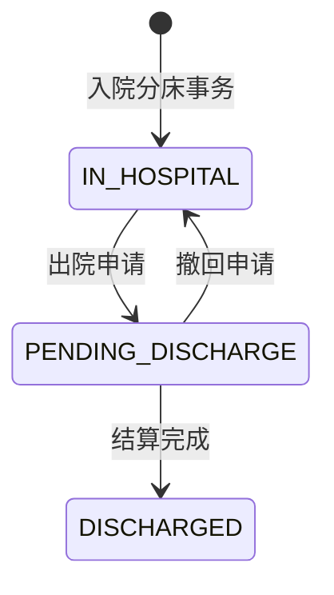
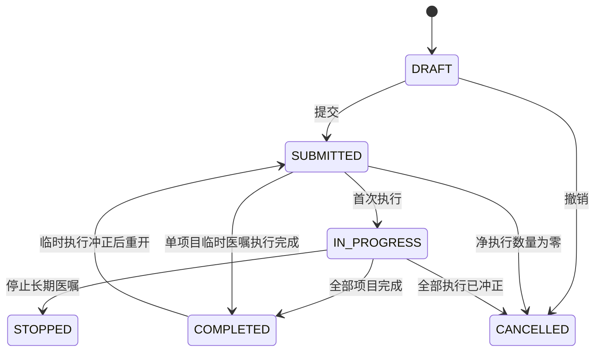

# 需求规格说明

## 目标与边界

系统服务于小型医院住院业务，覆盖患者入院、分床、押金、医嘱、执行计费、转床转科、欠费和出院结算。不包含门急诊、医保、线上支付、手术排程、完整电子病历、设备接口和采购供应链。

## 角色与权限

| 角色 | 权限代码 | 当前工作范围 |
| --- | --- | --- |
| 管理员 `ADMIN` | 全部权限 | 用户、角色、权限、审计及全部业务功能 |
| 住院处 `ADMISSION` | `PATIENT_READ`、`PATIENT_WRITE`、`ADMISSION_MANAGE`、`STATISTICS_READ` | 患者建档与维护、办理入院、分床和转床、申请出院、维护床位状态、查看统计 |
| 医生 `DOCTOR` | `PATIENT_READ`、`ORDER_WRITE`、`ORDER_EXECUTE`、`STATISTICS_READ` | 查询主管患者、创建及变更医嘱、执行由医生负责的非药品项目、查看统计 |
| 护士 `NURSE` | `PATIENT_READ`、`ORDER_EXECUTE`、`MEDICATION_ADMINISTER` | 查询本科室患者、执行护理类项目和护士给药；不能办理药房发药 |
| 药房 `PHARMACY` | `PATIENT_READ`、`ORDER_EXECUTE`、`PHARMACY_EXECUTE` | 查询患者与住院信息、执行医嘱、退药并冲正库存和费用 |
| 收费 `CASHIER` | `PATIENT_READ`、`DEPOSIT_MANAGE`、`SETTLEMENT_MANAGE`、`STATISTICS_READ` | 查询患者与费用、登记及冲正押金、处理欠费提醒、预检并完成出院结算、查看统计 |

权限代码的职责边界：

| 权限代码 | 受控操作 |
| --- | --- |
| `ADMIN_MANAGE` | 用户、角色、权限和审计管理 |
| `PATIENT_READ` | 患者、住院、床位、医嘱、费用及结算结果查询 |
| `PATIENT_WRITE` | 患者建档和资料修改 |
| `ADMISSION_MANAGE` | 办理入院、转床、申请出院和床位状态维护 |
| `ORDER_WRITE` | 创建医嘱及提交、停止、撤销、完成等状态操作 |
| `ORDER_EXECUTE` | 查询待执行任务并执行医嘱 |
| `MEDICATION_ADMINISTER` | 登记护士给药环节 |
| `PHARMACY_EXECUTE` | 退药及关联库存、费用冲正 |
| `DEPOSIT_MANAGE` | 登记和冲正押金、查询及处理欠费提醒 |
| `SETTLEMENT_MANAGE` | 结算预检和出院结算，也可查询欠费提醒 |
| `STATISTICS_READ` | 统计分析查询 |
| `AUDIT_READ` | 预留的独立审计查询权限；当前审计接口仍由 `ADMIN_MANAGE` 控制 |

前端菜单、路由和操作按钮按权限展示：无权限入口应隐藏；绕过界面直接访问受限路由时提示无权限并阻止进入。前端控制仅用于改善体验，所有受限接口仍由后端权限注解校验，后端返回的 403 是最终准入结果。

## 核心规则

- 同一患者只能有一条有效住院记录，同一床位同一时刻只能有一个有效占用记录。
- 转床必须关闭原床位历史、创建新历史并同步两个床位状态。
- 只有已提交或执行中的医嘱项目可以执行；执行请求号经过项目维度标准化后唯一，同一请求不能重复产生事实。
- 药品按 `DISPENSE` 发药、`ADMINISTER` 给药；非药品按 `PERFORM` 执行。发药扣库存并计费，给药不重复收费。
- 药品库存不足时，发药、库存流水和计费全部回滚。
- 押金余额为全部有效押金流水之和；费用总额为正向费用与冲正费用之和。
- 只有成功的发药或非药品执行才计费；价格和项目名称等信息在开立医嘱项目时保存快照。
- 临时用药按计划给药次数完成；配液组各项目的类型、时间及计划次数必须一致并原子执行。
- 未完成医嘱、可用余额不足或已结算均会阻止结算。
- 已发生的执行、库存、费用、押金、床位和结算事实不可物理删除。

## 状态机

## 非功能要求

- 普通查询目标 1 秒内，统计查询目标 3～5 秒内。
- JWT 签名令牌与数据库实时状态复核、BCrypt 密码哈希、参数校验、预编译 SQL、角色权限和审计日志。
- 金额不使用浮点类型；关键过程支持幂等、行锁和整体回滚。
- 基础数据软停用，关键业务只追加反向记录。

## 当前实现边界

数据库保留 PENDING/CANCELLED 住院状态用于后续扩展，当前页面/接口没有待入院预约或取消入院功能。长期医嘱仍为人工逐次执行，不提供按频次自动生成任务或定时调度；角色权限仅在创建用户时选择已有角色，不提供动态编辑角色定义。具体进展以 README 为准。

医生限其主管患者、护士限本科室；发药由药房/管理员办理。跨科转床必须结束原科室未完成医嘱并指定新主管医生。出院申请会暂停新增临床操作，撤回后恢复；结算后不可再改账或冲正，需要独立退款更正流程的需求尚不在当前范围。
